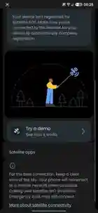
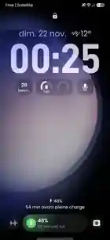
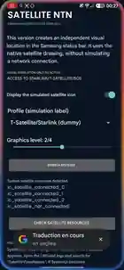
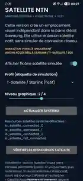

## 📸 Captures d’écran / Screenshots

| Paramètres satellite / Satellite settings | Écran verrouillé / Lock screen | Panneau rapide / Quick panel |
|:--:|:--:|:--:|
|  |  |  |

| Interface anglaise / English preview | Interface française / French preview |
|:--:|:--:|
|  |  |

*FR : Aperçus d’un Galaxy S23 de test modifié ; certains menus et libellés Samsung proviennent du système et ne sont pas des fonctionnalités de l’application. Les captures d’interface datent d’une version précédente ; l’anglais montré était traduit à l’écran. Le Wi-Fi est masqué. Aucune connexion satellite réelle.*

*EN: Preview shots from a modified Galaxy S23; some Samsung menus and network labels are part of that test device, not features enabled by this app. App screenshots were taken on an earlier version; the English view used on-screen translation. Wi-Fi name redacted. No real satellite connection.*

# 🇫🇷 Samsung SATIconEmul’ — Version 2.2.0

**Icône satellite fictive pour certains appareils Samsung One UI via LSPosed.**

### Fonctions
- Activation/désactivation d’une icône satellite purement visuelle dans la barre d’état Samsung.
- Affichage de ressources graphiques satellite natives de Samsung lorsque disponibles, dans un emplacement indépendant.
- Quatre profils d’étiquette : NTN, SOS, T-Satellite/Starlink, recherche (tous fictifs).
- Niveau graphique réglable de 0 à 4.
- Actualisation de SystemUI et diagnostic des ressources satellite intégrés.
- **Interface français + anglais dans une seule APK**, avec sélection automatique selon la langue Android (choix de langue par application disponible sur Android compatible).

### Installation
Télécharger **`Samsung-SATIconEmul-v2.2.0.apk`** ci-dessous. Root et LSPosed sont requis. Activer le module pour **`com.android.systemui` uniquement**, redémarrer, puis activer l’icône dans l’application.

**Compatibilité :** affichage précédemment observé sur un Galaxy S23 SM-S911U1 avec firmware modifié ; autres modèles et versions de One UI non garantis. Cette version bilingue n’est pas encore validée sur le matériel.

**Important :** ce module **n’active aucune connexion satellite**, aucun service Starlink/T-Satellite ni SOS. Il ne modifie pas les paramètres de réseau mobile ou de Wi-Fi. Ne pas utiliser l’indicateur pour évaluer les possibilités de contact avec les secours.

**Signatures des APK :** cette release est issue d’une compilation de développement signée par le runner GitHub Actions. La clé de signature peut différer des versions antérieures : si Android refuse une mise à jour, **ne désinstallez pas sans sauvegarder votre configuration et sans accepter de réactiver LSPosed**. Les mises à jour entre releases ne sont pas garanties tant qu’une clé de signature permanente n’est pas configurée.

Documentation complète : [README (FR/EN)](https://github.com/territoire-de-antoine-dev/Samsung-NTN-Icon-Emulator#readme).

---

# 🇬🇧 Samsung SATIconEmul’ — Version 2.2.0

**Simulated satellite status-bar icon for compatible Samsung One UI devices through LSPosed.**

### Features
- Toggle a **visual-only** satellite status-bar icon.
- Reuse native Samsung satellite icon resources where available, through a separate display slot.
- Four simulated display profiles: NTN, SOS, T-Satellite/Starlink, and searching.
- Adjustable graphic signal level (0–4).
- Built-in SystemUI refresh and satellite resource check.
- **French and English in one APK**, selected automatically based on the device language (per-app language selection on supported Android versions).

### Installation
Download **`Samsung-SATIconEmul-v2.2.0.apk`** from this release. A rooted phone and LSPosed are required. Enable the module for **`com.android.systemui` only**, reboot, then enable the visual indicator in the app.

**Compatibility:** earlier versions displayed an icon on a modified-firmware Galaxy S23 SM-S911U1. Compatibility with other devices and One UI versions is **not guaranteed**, and this bilingual version has not yet been device-tested.

**Safety:** this is **not actual satellite connectivity, Starlink/T-Satellite access or emergency SOS capability**. It does not change cellular or Wi-Fi settings. Do not rely on the simulated status icon for emergency communication.

**APK signatures:** release builds are currently debug-signed by a GitHub Actions runner; certificates may differ across builds. Android may reject an in-place update. **Do not uninstall your working version without preparing to restore preferences and LSPosed scope.** A permanent secure signing key is required for predictable upgrades.

Full documentation: [README (FR/EN)](https://github.com/territoire-de-antoine-dev/Samsung-NTN-Icon-Emulator#readme).
